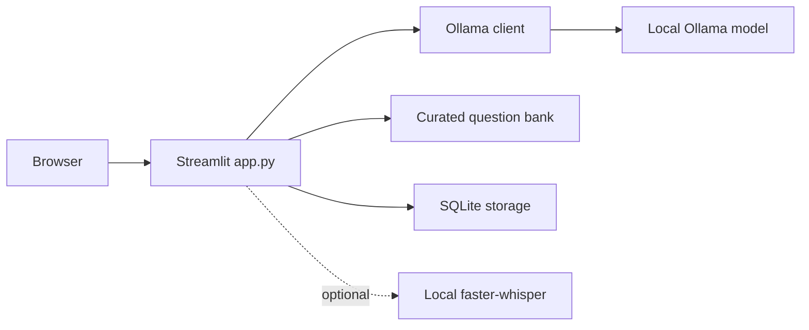

# ALTRON · English Teacher

**Conversational English Practice and Grammar Assistant**  
Fourth-year CSD mini project · Python + Streamlit + local Ollama + SQLite · no paid API key

## Abstract

SpeakSmart AI helps learners practise everyday English in a private, low-cost setting. A locally running language model acts as a conversation partner, replies with a follow-up question, and gives a short correction and explanation for the learner's latest message. A separate grammar lab checks a sentence or short paragraph. Curated grammar and vocabulary quizzes work without the model, while SQLite stores learner profiles, conversation history, grammar checks, and quiz results. An optional local speech-to-text module lets learners record a message and review its transcript before sending it. The project demonstrates a complete AI-assisted learning workflow without a paid cloud API.

## Features

- Topic-based, multi-turn conversation practice with gentle correction, explanation, and vocabulary tip.
- Grammar lab with a corrected version, explanation, and two examples.
- 12 built-in quiz questions in grammar and vocabulary with instant feedback.
- Random grammar chat: ALTRON picks a teacher-checked grammar question, checks the answer locally, then uses the free local Ollama API for a short reply and follow-up questions.
- Multiple local learner profiles, persistent chat sessions, saved checks, and quiz history.
- Progress cards showing practice counts and quiz accuracy.
- A configurable daily activity goal counting conversation messages, grammar checks, and quiz answers for each local learner profile.
- Optional microphone recording and local transcription using `faster-whisper`.
- Clear Ollama connection/model status. The quiz remains usable when Ollama is stopped.

## Requirements

- Python **3.10 or newer** (3.11 recommended).
- [Ollama](https://ollama.com/download) installed and running locally.
- Around **1.4 GB** of free disk space for the recommended [`qwen3:1.7b` model](https://ollama.com/library/qwen3%3A1.7b), plus memory to run it. A smaller `qwen3:0.6b` model is also available, though its answers may be weaker.
- Internet access for the initial package and model downloads. After setup, text features run locally.
- A modern browser; a microphone is needed only for optional voice input.

## Setup and run

Open a terminal **inside this project folder**.

On Windows, after installing Ollama and pulling the model, you can also double-click `run_windows.bat`. It creates the Python environment on first use and starts the app.

For an optional Codex CLI session using the same local Ollama model, double-click `run_codex_ollama.bat`. It starts Codex in read-only mode. The 1.7B model is suitable for a basic connection test; use a stronger model for serious coding work. This launcher does not change your usual Codex settings.

### Windows PowerShell

```powershell
python -m venv .venv
.venv\Scripts\Activate.ps1
python -m pip install -r requirements.txt
ollama pull qwen3:1.7b
python -m streamlit run app.py
```

If PowerShell blocks activation, use `.venv\Scripts\python.exe -m pip install -r requirements.txt` and `.venv\Scripts\python.exe -m streamlit run app.py` instead. Start the Ollama desktop app first; if needed, run `ollama serve` in a separate terminal. Streamlit prints a local address, usually `http://localhost:8501`.

### macOS / Linux

```bash
python3 -m venv .venv
source .venv/bin/activate
python -m pip install -r requirements.txt
ollama pull qwen3:1.7b
python -m streamlit run app.py
```

Keep Ollama running while using Conversation and Grammar lab. Select **Demo Learner**, choose a topic, and send a message. The SQLite file is created automatically at `data/speaksmart.db`.

### Optional voice input

```bash
python -m pip install -r requirements-voice.txt
```

Open **Conversation → Optional voice input**, record a short message, then select **Transcribe recording**. Review the transcript in the message box before sending. The first transcription downloads the free `tiny.en` speech model; later transcriptions can run locally. Voice quality depends on microphone quality and pronunciation. Text input remains the primary path.

### Optional sample history

```bash
python sample_data/seed_demo.py
```

This adds one clearly illustrative chat exchange, grammar check, and quiz attempt to an *empty* Demo Learner profile. It does not call Ollama. It skips a profile that already has history.

## How to use

1. **Conversation:** Choose a new topic or reopen a saved session. Type in the **Your message** box near the top and press **Send message**; past messages appear below. You can also record a message in the optional voice section.
2. **Grammar lab:** Enter a sentence such as `She go to college yesterday.` and inspect the correction, reason, and examples.
3. **Grammar chat:** Answer a random grammar question, read the checked answer and example, and ask ALTRON follow-up questions. Use **Ask another random grammar question** for a new one.
4. **Quick quiz:** Pick Grammar or Vocabulary, answer, read the explanation, and continue through the set.
5. **Progress & history:** Set a daily activity goal and review today's count, quiz attempts, grammar checks, and past conversations. Use the learner selector to keep profiles separate.

## Architecture



| File | Purpose |
| --- | --- |
| `app.py` | Streamlit screens and interaction flow |
| `run_windows.bat` | Double-click launcher and first-run Python setup for Windows |
| `speaksmart/ollama_client.py` | Local model request, prompts, and response validation |
| `speaksmart/db.py` | SQLite schema and database operations |
| `speaksmart/quiz.py` | Question loading and answer checking |
| `speaksmart/voice.py` | Optional offline speech transcription |
| `sample_data/questions.json` | Curated sample quiz bank |
| `sample_data/seed_demo.py` | Optional illustrative history |
| `tests/test_core.py` | Unit tests for storage, model adapter, and quiz |
| `TEST_REPORT.md` | Results of unit tests and live application checks |

The app sends only the latest message and up to eight recent chat messages to the model for context. AI output is validated before it is saved. A small rule-based check gives grounded explanations for common one-word verb corrections, because small models can invent grammar rules. Grammar chat always grades against the curated answer key and shows its verified explanation; Ollama's extra reply can still be imperfect. Grammar chat quiz attempts are saved in SQLite; follow-up chat text stays in the current Streamlit session. The database uses one short-lived connection per operation. User data stays on the machine running Streamlit; if you expose the app over a network, other people with access to that server could view the local learner profiles.

## Configuration

Defaults are suitable for one computer. Optional environment variables:

| Variable | Default | Use |
| --- | --- | --- |
| `SPEAKSMART_MODEL` | `qwen3:1.7b` | Use another model already pulled into Ollama |
| `OLLAMA_URL` | `http://127.0.0.1:11434` | Local Ollama address; only local HTTP addresses are accepted |
| `SPEAKSMART_DB` | `data/speaksmart.db` | SQLite database path |

Example: `SPEAKSMART_MODEL=qwen3:0.6b` after running `ollama pull qwen3:0.6b` (use PowerShell `$env:SPEAKSMART_MODEL="qwen3:0.6b"`).

## Tests

From the project folder:

```bash
python -m unittest discover -s tests -v
python -m compileall -q app.py speaksmart sample_data
```

The tests use a temporary SQLite database and a mocked Ollama response, so Ollama is not required for them. A real AI response and microphone transcription require Ollama/model and optional voice dependencies on your computer.

## Scope and limitations

This is a single-computer educational MVP, with no sign-in or cloud sync in the Streamlit app. The hosted ALTRON quiz has a separate optional Google login; its browser progress does not sync with this SQLite database. Grammar feedback comes from a language model and can be imperfect; learners should treat it as guidance. Quiz accuracy measures performance on this small question bank only. The first model downloads need internet, but no paid API or account is required for the local app.
